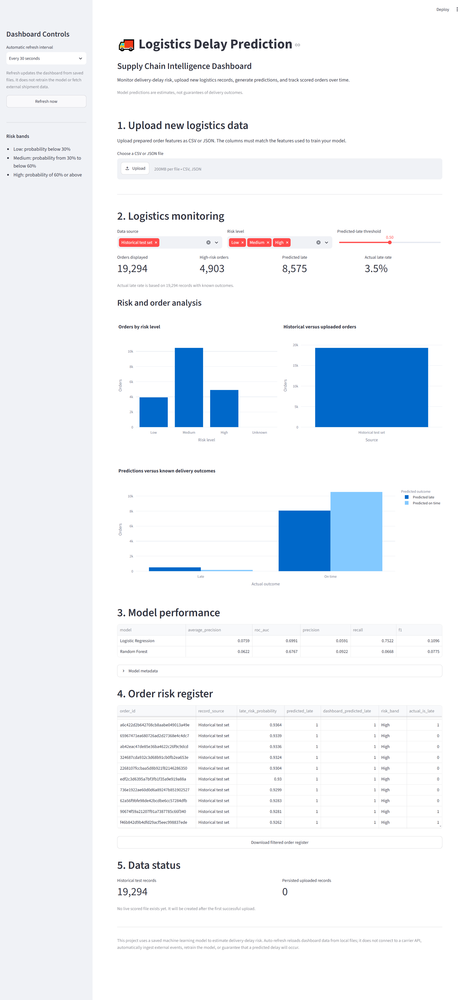

# Industrial Predictive Maintenance

An end-to-end machine learning project for predicting industrial equipment failure risk using sensor and operating-condition data. The project combines data preprocessing, exploratory analysis, model training, evaluation, and a Streamlit interface for predictive maintenance decision support.

## Project Overview

Unexpected equipment failures can lead to unplanned downtime, production losses, and higher maintenance costs. This project explores how machine learning can help identify potentially high-risk machine records and support proactive maintenance planning.

## Objectives

- Analyse industrial sensor and operating-condition data.
- Explore failure patterns and relationships between features.
- Train a machine learning classification model.
- Evaluate predictions using precision, recall, F1-score, ROC-AUC and PR-AUC where available.
- Provide an interactive application for exploring failure-risk predictions.

## Dataset

**UCI AI4I 2020 Predictive Maintenance Dataset**

Source: https://archive.ics.uci.edu/dataset/601/ai4i+2020+predictive+maintenance+dataset

The dataset is synthetic and intended for educational and experimental use. It includes machine operating parameters and failure labels.

## Project Workflow

1. Data acquisition and validation
2. Data cleaning and preprocessing
3. Exploratory data analysis (EDA)
4. Feature preparation and model training
5. Test-set evaluation and classification analysis
6. Prediction interface using Streamlit

## Visual Results

### Application Preview



> If a visual is not generated yet, create it and save it at the specified path, or remove its image block until it is available. Only publish measured metrics from your actual test results.

## Technology Stack

- **Language:** Python
- **Data processing:** Pandas, NumPy
- **Machine learning:** scikit-learn
- **Visualisation:** Plotly and Matplotlib, where used
- **Application:** Streamlit
- **Environment:** Jupyter Notebook, VS Code or GitHub Codespaces
- **Version control:** Git and GitHub

## Run the Project Locally

### 1. Clone the repository

```bash
git clone https://github.com/sm292/industrial-predictive-maintenance.git
cd industrial-predictive-maintenance
```

### 2. Create and activate a virtual environment

**Windows:**

```bash
python -m venv .venv
.venv\\Scripts\\activate
```

**Linux/macOS:**

```bash
python3 -m venv .venv
source .venv/bin/activate
```

### 3. Install dependencies

```bash
python -m pip install -r requirements.txt
```

### 4. Download the dataset and train the model

```bash
python download_data.py
python train_model.py
```

### 5. Launch the application

```bash
streamlit run app.py
```

Run the commands from the repository root. Ensure the training script and application use the same saved model and data paths.

## Model Performance Comparison

| Model | Average Precision | ROC-AUC | Precision | Recall | F1-Score |
|---|---:|---:|---:|---:|---:|
| Logistic Regression | 0.075921 | 0.699142 | 0.059125 | 0.752226 | 0.109633 |
| Random Forest | 0.062226 | 0.676675 | 0.092213 | 0.066766 | 0.077453 |
### Key Findings

- **Logistic Regression:** Achieved higher Average Precision, ROC-AUC, recall, and F1-score among the two models.
- **Random Forest:** Achieved higher precision but substantially lower recall.
- **Model Selection:** Logistic Regression is the stronger candidate when detecting as many actual equipment failures as possible is the priority. However, its low precision indicates that many predicted failures may be false alarms.
- **Next Steps:** Evaluate the precision-recall curve, tune the classification threshold, and validate performance on an independent test set.


Because equipment failures may be rare, accuracy alone is not sufficient. Threshold selection should consider the relative costs of missed failures and unnecessary inspections.

## Business Applications

- Prioritising machine inspections
- Supporting preventive maintenance planning
- Exploring sensor patterns associated with equipment failure
- Reducing dependence on purely reactive maintenance strategies
- Building a foundation for future industrial monitoring systems

## Limitations

- The dataset is synthetic and may not represent real factory conditions.
- Model performance depends on data quality, feature selection and test methodology.
- Predictions require validation on representative operational data before deployment.
- The application is a portfolio project, not a certified industrial safety system.

## Future Improvements

- Compare multiple classification algorithms and tune decision thresholds.
- Add explainability using SHAP or permutation importance where supported.
- Implement batch prediction and downloadable reports.
- Add data-drift monitoring and model-version tracking.
- Deploy the application with appropriate validation, monitoring and access controls.

## Author

**Sumit Mondal**

GitHub: https://github.com/sm292

LinkedIn: https://www.linkedin.com/in/sumit-mondal-6a07b0174

---

*Built as a machine learning portfolio project focused on industrial analytics and predictive maintenance.*
